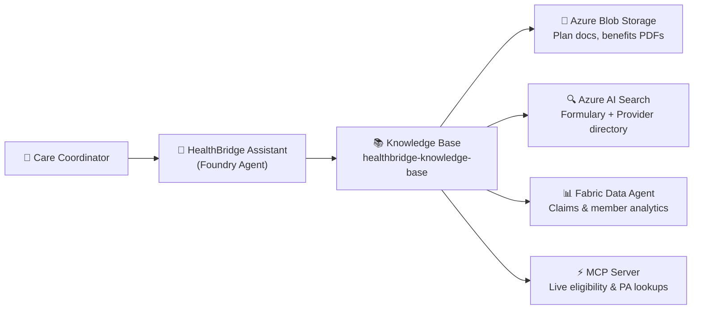

# Knowledge IQ Demo — Azure AI Foundry (Healthcare Payor)

> Demonstrates **Knowledge IQ** in the new Azure AI Foundry for a healthcare payor audience — connecting four heterogeneous data sources into a single AI-queryable Knowledge Base, surfaced through a governed prompt agent.

**Brand:** HealthBridge Insurance Plan / HealthBridge Insurance (all data is synthetic)  
**Platform:** [New Azure AI Foundry](https://ai.azure.com) — not Azure AI Studio or classic Foundry

---

## What This Demo Shows

A care coordinator asks a single agent about a member's benefits, prior authorization requirements, formulary coverage, and provider network — all in plain language. The agent answers from four different live data sources and cites every fact.



---

## Data Sources

| Source | What It Holds | Query Types |
|---|---|---|
| **Azure Blob Storage** | SBC PDFs, Evidence of Coverage, benefits summaries, PA policies | Benefits, OOP max, coverage criteria |
| **Azure AI Search** | Formulary index, provider directory index | Drug tiers, step therapy, in-network providers |
| **Fabric Data Agent** | Claims history, deductible accumulators, utilization analytics | Claim status, denial reasons, deductible YTD |
| **MCP Server** | Live member eligibility, claim lookups, benefits by plan | Real-time eligibility, PA requirements, live claim status |

> ⚠️ **Fabric Data Agent** connection configuration is pending — details will be provided by the project team. All other data sources are fully functional for demo.

---

## Quick Start

Three commands to get the MCP server running locally:

```bash
cd data-sources/mcp-server
npm install
npm start
```

Verify the server and sample data are healthy:

```bash
node test-tools.mjs
# Expected: 16 passed, 0 failed
```

For the full environment (Azure resources + Knowledge Base + agent), see **[docs/setup-guide.md](docs/setup-guide.md)**.

---

## Architecture

```
data-sources/
  mcp-server/          # Node.js MCP server — live member/claims/benefits tools
  ai-search/           # AI Search index schema + skillset config
  fabric-data-agent/   # Fabric Data Agent connection config (pending)
  blob-storage/        # PowerShell deploy script — upload plan documents
sample-data/           # Shared synthetic healthcare data (members, claims, providers, benefits)
agent/                 # Foundry agent definition, system prompt, sample prompts
docs/                  # Setup guide, demo scripts, architecture overview
```

All member, provider, and claim IDs are consistent across sources (e.g., member `MBR-2024-001234` appears in MCP server data, claims records, and benefits summaries). This enables compelling cross-source demo prompts.

---

## Demo Prompts (Sample)

These prompts run against the deployed `healthbridge-assistant` agent in Foundry Playground:

| Prompt | Primary Source |
|---|---|
| "Is Dr. Patricia Chen an in-network provider?" | AI Search — provider index |
| "Is Ozempic covered, and what tier is it?" | AI Search — formulary index |
| "What is the out-of-pocket max on the PPO Gold plan?" | Blob Storage — SBC PDF |
| "Does an MRI of the knee require prior authorization?" | MCP Server |
| "Why was my ER claim from March 3rd denied?" | Fabric Data Agent |

Full prompt library (15 functional + 3 guardrail): [`agent/sample-prompts.md`](agent/sample-prompts.md)

---

## Important Notes

- **All sample data is fully synthetic.** No real PHI or PII is present anywhere in this repository.
- This demo targets the **new Azure AI Foundry** only (`ai.azure.com`). Do not reference Azure AI Studio or classic Foundry APIs.
- Each data source is independently demoable. The Knowledge Base functions with any subset of sources connected.

---

## Documentation

| Document | Description |
|---|---|
| [`docs/setup-guide.md`](docs/setup-guide.md) | Complete step-by-step setup — prerequisites through agent deployment |
| [`docs/demo-script.md`](docs/demo-script.md) | Presenter scripts — 3-minute and 10-minute versions |
| [`docs/architecture.md`](docs/architecture.md) | Architecture deep-dive — data flow, component roles, MCP integration |
| [`docs/demo-flow.md`](docs/demo-flow.md) | Full 45-minute narrative demo flow with Q&A |
| [`docs/azure-setup.md`](docs/azure-setup.md) | Azure provisioning reference (CLI commands for all resources) |
