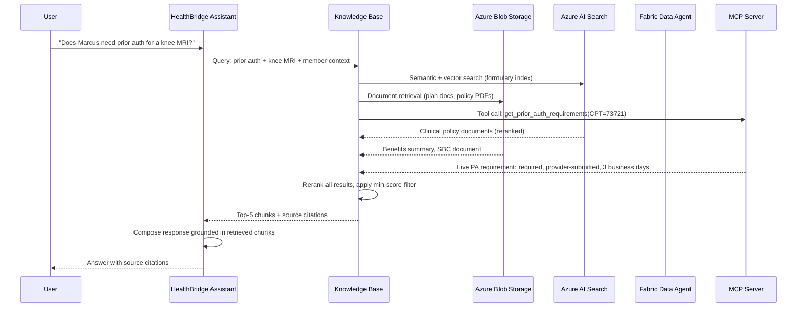

# Architecture — HealthBridge Knowledge IQ Demo

**Audience:** Engineers and architects evaluating the Azure AI Foundry Knowledge IQ pattern.  
**New Azure AI Foundry only** — do not reference Azure AI Studio or classic Foundry APIs.

---

## Overview

This demo implements a multi-source Knowledge Base using **Knowledge IQ in Azure AI Foundry**. The Knowledge Base federates four architecturally distinct data sources — real-time API, vector search, structured analytics, and document storage — behind a single agent endpoint. No data is copied or centralized; Foundry connects to each source at query time.

The agent, **HealthBridge Assistant**, answers healthcare payor questions (benefits, prior authorization, formulary, claims, provider network) by querying the Knowledge Base and citing its sources in every response.

---

## Component Map

```
┌─────────────────────────────────────────────────────────────────┐
│                    Azure AI Foundry                             │
│                                                                 │
│   ┌─────────────────────────────────────────────────────┐      │
│   │           HealthBridge Assistant (Agent)            │      │
│   │        gpt-4o  │  temp: 0.1  │  guardrails on      │      │
│   └──────────────────────┬──────────────────────────────┘      │
│                           │                                     │
│   ┌───────────────────────▼────────────────────────────┐       │
│   │        healthbridge-knowledge-base                 │       │
│   │   Hybrid search · Semantic ranker · Top-K=5        │       │
│   └───┬────────────┬────────────┬──────────────┬───────┘       │
│       │            │            │              │               │
└───────┼────────────┼────────────┼──────────────┼───────────────┘
        │            │            │              │
        ▼            ▼            ▼              ▼
  ┌──────────┐ ┌──────────┐ ┌──────────┐ ┌──────────────┐
  │  Azure   │ │  Azure   │ │  Fabric  │ │   MCP Server │
  │   Blob   │ │   AI     │ │   Data   │ │  (Container  │
  │ Storage  │ │  Search  │ │  Agent   │ │    Apps)     │
  │          │ │          │ │          │ │              │
  │ Plan     │ │Formulary │ │ Claims & │ │ Live member  │
  │ docs,    │ │ index +  │ │ member   │ │ eligibility, │
  │ benefits │ │ provider │ │analytics │ │ PA lookups,  │
  │ summaries│ │ index    │ │ lakehouse│ │ benefits     │
  └──────────┘ └──────────┘ └──────────┘ └──────────────┘
```

---

## Data Flow

### Query-Time Flow



---

## Data Sources — Roles and Query Types

### Azure Blob Storage

**What it holds:**
- Summary of Benefits and Coverage (SBC) — plan-level PDF documents
- Evidence of Coverage documents — full policy text
- Prior authorization policy files
- Member-facing benefits summaries (one per plan type × metal tier)

**Query types it handles best:**
- "What is my out-of-pocket maximum?"
- "Is bariatric surgery covered?"
- "What does my plan say about physical therapy visit limits?"
- "What are my rights in an appeal?"

**How it connects:** Foundry Blob Storage connection → `healthcare-docs` container → automatic chunking and embedding at indexing time.

**Retrieval method:** Dense vector search on pre-indexed document chunks.

---

### Azure AI Search

**What it holds:**
- Formulary index (`healthbridge-formulary-index`) — drug tiers, quantity limits, step therapy requirements, specialty pharmacy flags
- Provider directory index (`healthbridge-provider-index`) — physician network status, specialties, locations, quality scores, panel status

**Query types it handles best:**
- "What tier is Ozempic on the formulary?"
- "Is there a preferred biosimilar for Humira?"
- "Is Dr. Chen in-network and accepting new patients?"
- "Find orthopedic surgeons near ZIP 62701"

**How it connects:** Foundry AI Search connection → named index → hybrid (keyword + vector) search with semantic reranker.

**Retrieval method:** Hybrid search (BM25 + HNSW vectors) with semantic reranker using `text-embedding-3-small`.

---

### Fabric Data Agent

**What it holds:**
- Claims adjudication records — status, denial codes, billed/allowed/paid amounts
- Member accumulators — year-to-date deductible, out-of-pocket accumulation
- Prior authorization requests — status, pending items, required documentation
- Utilization analytics — denial patterns by specialty, plan type, time period

**Query types it handles best:**
- "What is the status of my most recent claim?"
- "Why was my ER claim from March 3rd denied?"
- "How much have I spent toward my deductible this year?"
- "What are the top denial codes for ortho claims in the last 12 months?"

**How it connects:** Foundry Fabric Data Agent connection → structured natural-language-to-query translation over the lakehouse schema.

**Retrieval method:** Natural language query → Fabric Data Agent translates to structured analytics query → returns structured results.

> ⚠️ **Configuration pending** — Fabric Data Agent connection details will be provided separately. Prompts targeting this source can be skipped until configured.

---

### MCP Server

**What it holds (tools):**
- `lookup_member` — member demographics, plan enrollment, eligibility status, effective dates
- `lookup_claim` — claim status and adjudication details by claim ID or member
- `check_benefits` — in-network/out-of-network coverage, deductibles, copays, prior auth flags

**Query types it handles best:**
- "Is member MBR-2024-001234 currently eligible?"
- "What is the status of claim CLM-2026-0054321?"
- "Does a knee MRI require prior auth under this plan?"
- "What is the deductible for a PPO Gold member?"

**How it connects:** Foundry MCP Server connection → HTTP endpoint (Azure Container Apps) → standard MCP JSON-RPC protocol → stdio server → in-memory data loaded from `sample-data/`.

**Retrieval method:** Direct tool invocation — the agent calls specific MCP tools with structured parameters. Not semantic search; these are function calls.

---

## How the Knowledge Base Combines Sources

At query time, Foundry's Knowledge Base performs these steps:

1. **Query rewriting** — the user's natural language question is rewritten into a structured retrieval query optimized for each source type.

2. **Fan-out retrieval** — all connected sources are queried simultaneously. AI Search and Blob use vector/hybrid search; MCP uses tool calls; Fabric uses the Data Agent query interface.

3. **Reranking** — all returned chunks are scored by the semantic reranker. Chunks below the minimum score threshold (0.5) are dropped. Top-K=5 chunks are passed to the agent.

4. **Response synthesis** — the agent composes a response grounded only in the retrieved chunks. Every factual claim maps to a cited source.

5. **Citation assembly** — citations list the source document name, source type, and (for AI Search) the reranker confidence score.

---

## MCP Server Integration Detail

The MCP server is the most architecturally interesting source because it uses the **Model Context Protocol** — an open standard for connecting AI agents to external tools.

```
Foundry Agent
    │
    │  Foundry MCP connection (HTTP)
    ▼
Azure Container App (HTTPS endpoint)
    │
    │  stdio bridge
    ▼
Node.js MCP Server (server.js)
    │
    │  readFileSync at startup
    ▼
sample-data/ JSON files
  members/   claims/   benefits/   policies/   providers/
```

**Why MCP matters for payors:**  
Any existing payor system (Epic, Facets, HealthEdge, claims warehouses) can be wrapped in an MCP server without changing the underlying system. The protocol is model-agnostic and vendor-neutral. Once wrapped, the system becomes queryable from any MCP-compatible AI client — not just Foundry.

**Tools exposed by this server:**

| Tool | Parameters | Returns |
|---|---|---|
| `lookup_member` | `memberId` or `name` | Demographics, plan, eligibility, effective dates |
| `lookup_claim` | `claimId` or `memberId` | Status, codes, billed/allowed/paid, denial reason |
| `check_benefits` | `memberId`, `serviceCategory` | Coverage, cost-sharing, prior auth requirement |

---

## Key Architectural Decisions

| Decision | Choice | Rationale |
|---|---|---|
| Number of data sources | 4 | Covers all major payor data categories with maximum architectural diversity |
| Sample data location | `sample-data/` (shared) | Single source of truth; consistent member/provider/claim IDs across all sources |
| MCP transport | stdio → HTTP proxy | Standard MCP pattern; easy to swap for production endpoint |
| Search configuration | Hybrid + semantic ranker | Best recall/precision balance for medical terminology |
| Agent temperature | 0.1 | Low temperature required for consistent guardrail behavior |
| Embedding model | `text-embedding-3-small` | Cost-effective for demo; upgrade to `text-embedding-3-large` for production |

See `docs/setup-guide.md` for implementation details and `.squad/decisions.md` for the full ADR.

---

## Repository Layout

```
foundry-knowledge-iq-demo/
├── data-sources/
│   ├── mcp-server/              # Node.js MCP server (ESM, stdio transport)
│   │   ├── server.js            #   MCP tool implementations
│   │   ├── test-tools.mjs       #   Smoke test / verification script
│   │   └── package.json         #   Node 18+, @modelcontextprotocol/sdk
│   ├── ai-search/
│   │   ├── index-schema.json    #   Shared index schema (formulary + provider)
│   │   └── skillset.json        #   Chunking, entity extraction, embedding
│   ├── blob-storage/
│   │   └── deploy.ps1           #   PowerShell: create account + upload docs
│   └── fabric-data-agent/
│       └── connection-config.json  #   Fabric workspace connection (pending)
├── sample-data/
│   ├── members/                 #   3 synthetic members (JSON)
│   ├── claims/                  #   3 synthetic claims (JSON)
│   ├── providers/               #   3 synthetic providers (JSON)
│   ├── benefits/                #   Benefit summaries by plan × tier (Markdown)
│   └── policies/                #   Prior auth and clinical policy documents
├── agent/
│   ├── agent-definition.json    #   Foundry agent import definition
│   ├── knowledge-base-config.json  # KB config — all 4 source connections
│   ├── system-prompt.md         #   Full system prompt with guardrails
│   └── sample-prompts.md        #   15 functional + 3 guardrail test prompts
└── docs/
    ├── setup-guide.md           #   Step-by-step setup (this guide's companion)
    ├── demo-script.md           #   3-min and 10-min presenter scripts
    ├── demo-flow.md             #   45-min full narrative flow
    ├── azure-setup.md           #   Azure provisioning reference
    └── architecture.md          #   This file
```

---

*Architecture version: 1.0 | Created: 2026-06-05 | New Azure AI Foundry (ai.azure.com) only*
